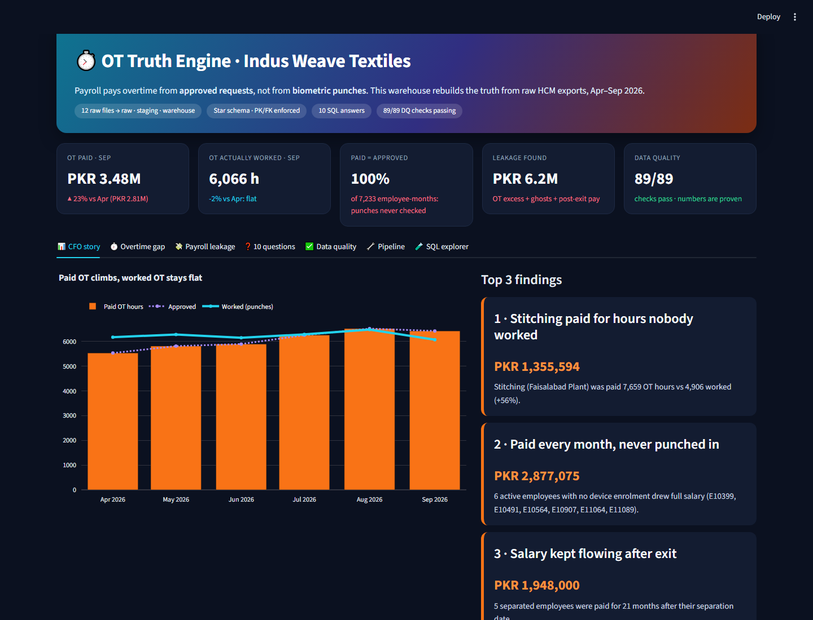
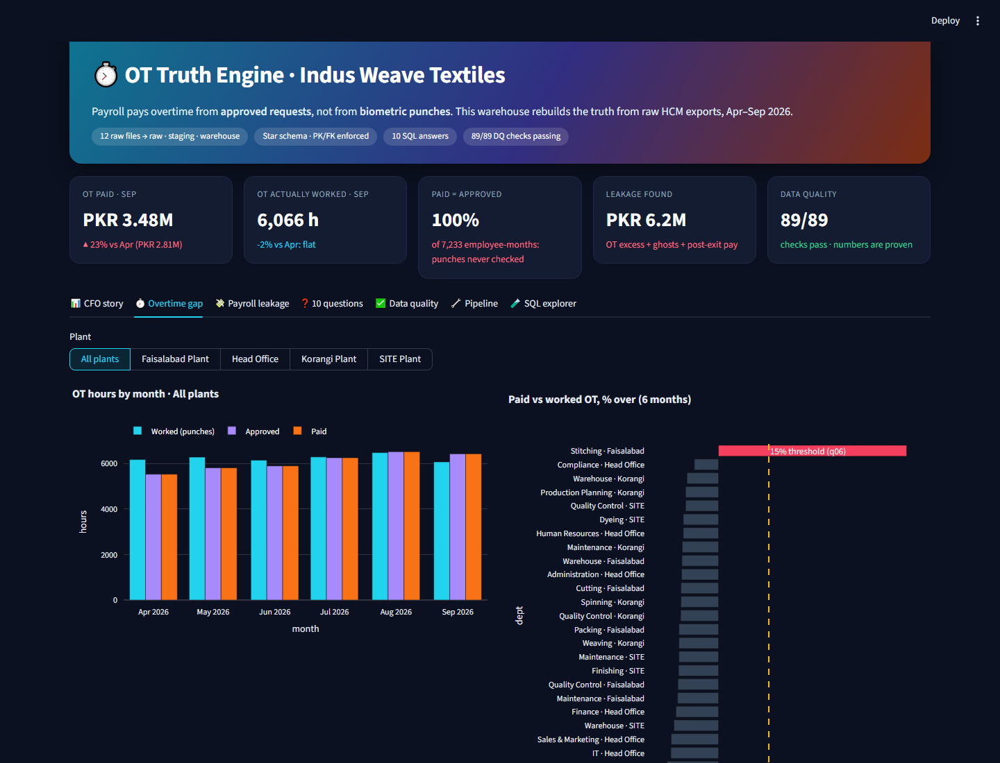
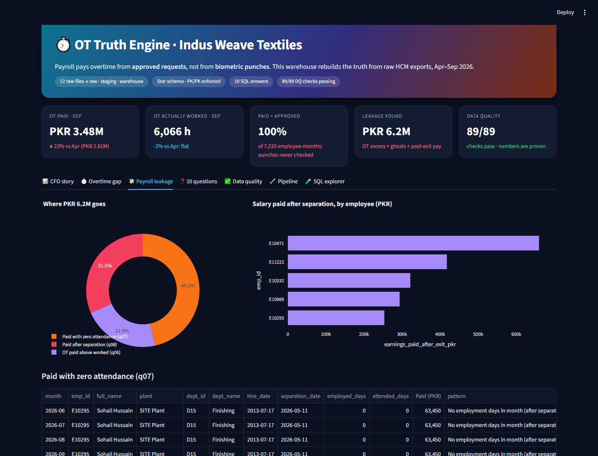
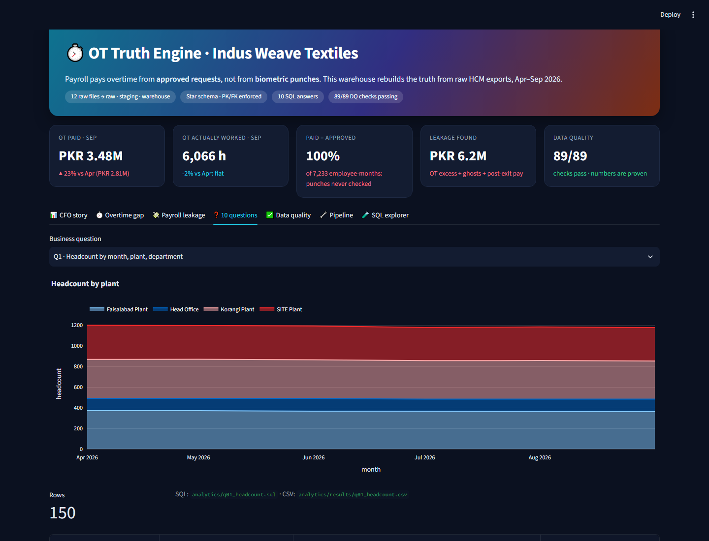
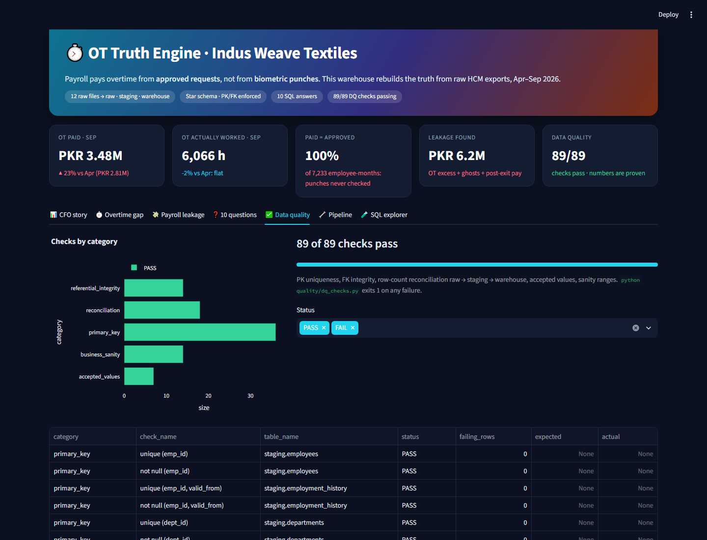
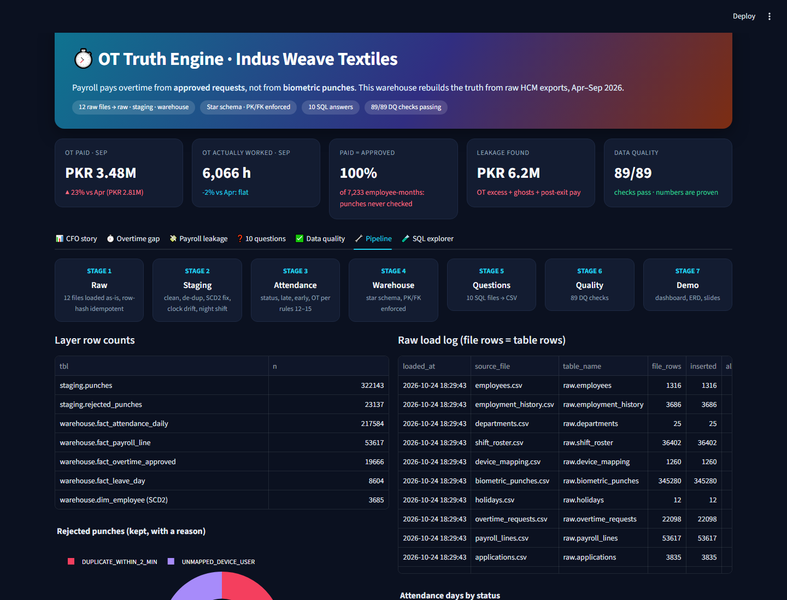

# Indus Weave HR Pipeline: OT Truth Engine

A Python + SQL pipeline that turns six months of messy HCM exports (Apr–Sep 2026) into a trusted star-schema warehouse. It answers the 10 business questions and shows the CFO where the overtime money goes.

**Headline:** OT paid rose **+23%** (PKR 2.81M to 3.48M a month) while the OT worked by the punch clock stayed flat. Payroll pays approved requests 1:1. See [`presentation/cfo_findings.md`](presentation/cfo_findings.md) for the three findings (about PKR 6.2M of leakage).

**New to the code?** Start with [`docs/HOW_IT_WORKS.md`](docs/HOW_IT_WORKS.md): a stage-by-stage walkthrough with the key code and one employee-day traced from raw punch to CFO number.

## Screenshots
**CFO story:** paid OT climbs while OT worked by the punch clock stays flat, plus the top 3 findings.


| Overtime gap by plant and department | Payroll leakage |
|---|---|
|  |  |
| **All 10 questions: chart, table and SQL** | **89 data-quality checks** |
|  |  |

**Pipeline view:** stages, row counts per layer, raw load log, rejected punches.


## Rebuild from scratch (clean machine)
Requires Python 3.11+. No database server is needed: SQLite is allowed by the brief.
```bash
python -m venv .venv
.venv\Scripts\activate            # macOS/Linux: source .venv/bin/activate
pip install -r requirements.txt
# unzip indus_weave_hcm_data.zip so the 12 files + data_dictionary.md are in data/raw/
python run_pipeline.py --fresh    # ~80 s: raw -> staging -> warehouse -> answers -> DQ -> ERD/slides
streamlit run dashboard/app.py    # bonus dashboard
```
Output: `db/raw.db`, `db/staging.db`, `db/warehouse.db` (ATTACHed as schemas `raw`, `staging`, `warehouse`, so all SQL is schema-qualified as in PostgreSQL), `analytics/results/*.csv`, `warehouse.dq_results`.
Re-running `python run_pipeline.py` is idempotent: raw rows are keyed on `_row_hash`, so a repeated load inserts 0 rows, and every later layer is rebuilt deterministically.

## Layout
| Path | Stage | What |
|---|---|---|
| `ingestion/load_raw.py` | 1 | Files go into `raw.*` as TEXT, untouched (JSON = one row per element). Adds `_source_file`, `_loaded_at`, `_row_hash`. `raw._load_log` compares file rows with table rows |
| `transform/stage2_clean.py` | 2 | Typed, trimmed tables with ISO dates. Employee de-dup with merge log, SCD2 history fix, roster forward-fill, leave flattening + leave days, clock-drift detection |
| `transform/sql/02_punches.sql` | 2 | Device mapping, clock correction, 2-minute de-dup (`LAG`), night-shift date. Rejected punches go to `staging.rejected_punches` with a reason |
| `transform/sql/03_attendance_daily.sql` | 3 | `staging.attendance_daily`: status, worked/late/early/OT per rules 12–15 |
| `warehouse/ddl/*.sql`, `load_warehouse.sql`, `erd.png` | 4 | Star schema with PK/FK enforced (`PRAGMA foreign_keys=ON`, `foreign_key_check` = 0) |
| `analytics/q01…q10*.sql`, `results/` | 5 | One SQL file per question (CTEs + window functions), one CSV each |
| `quality/dq_checks.py` | 6 | 89 checks (PK, FK, reconciliation, accepted values, sanity) go to `warehouse.dq_results`. Exit code 1 on any failure |
| `run_pipeline.py` | bonus | One-command rebuild, `--fresh`, `--incremental` |
| `analytics/bonus_recruitment_funnel.sql` | bonus | Funnel conversion + median days per stage |
| `dashboard/app.py` | bonus | Streamlit (dark theme in `.streamlit/config.toml`): CFO story, OT gap by plant, leakage, all 10 questions with chart + SQL, DQ ledger, pipeline view, SQL explorer |
| `docs/HOW_IT_WORKS.md` | guide | Code walkthrough: every stage, key code, worked example |
| `presentation/` | demo | `cfo_findings.md`, `slides.pdf` (7 slides), `make_visuals.py` |

## Planted data issues: found, fixed in code, documented
| Issue | How we found it | Fix (code) | Count |
|---|---|---|---|
| Duplicate employees | `emp_id` repeated | Keep latest `updated_at` (rule 1). Dropped rows and the differing fields are in `staging.employee_merge_log` | 50 rows |
| 3 date formats | pattern profiling | `parse_mixed_date` (YYYY-MM-DD, DD/MM/YYYY, DD-Mon-YYYY). Fails loudly on any unknown format | all date cols |
| Messy / old department names | 81 text variants | trim + collapse spaces + lower-case, matched on (plant, current OR previous name). Procurement→D04, Processing→D15 | 0 unmapped |
| `effective_to` overlaps/gaps | compared with next `effective_from` | `valid_to` = next start − 1 day, latest row open (rule 2). Fix noted per row in `effective_to_fix` | 25 overlaps + 12 gaps (37 emps) |
| Two history rows on the same day (E11259) | duplicate (emp, effective_from) | Earlier row is zero-length, so it goes to `staging.rejected_employment_history` | 1 |
| Missing roster weeks | emp × week grid | Forward-fill from previous week (rule 6), `is_imputed = 1` | 407 in period |
| Unmapped device users (contractors) | no `device_id + device_user_id` mapping | `staging.rejected_punches` with reason `UNMAPPED_DEVICE_USER` | 6,962 |
| Device clock 1 h off | daily median (first punch − shift start) per device vs other devices | DEV-SITE-01 is +60 min from 2026-07-01 (median diff 59.8 vs 0.1 before). Detected automatically → `staging.device_clock_corrections`, then subtracted | 1 device |
| Punches seconds apart | `LAG` per employee | ≤120 s from previous punch goes to rejected (`DUPLICATE_WITHIN_2_MIN`) | 16,175 |
| Night shift crosses midnight | roster | Punch before 12:00 after a NIGHT day (or before 04:00 after EVE) belongs to the previous date, unless today is a DAY/GEN shift (new roster week) | 0 shift-days with >2 punches |
| Missing check-outs | 1 punch on a shift date | Status `Missing Punch` | 2,493 |
| Nested leave approvals | JSON | `leave_requests` (1 row/request) + `leave_approvals` (1 row/step). Valid only if Manager AND HR Approved and not cancelled | 4,282 valid of 5,372 |
| Leave over Sundays/holidays | calendar | Sundays + plant holidays are not leave days (rule 17); `days_requested` ignored | 8,604 leave days |
| OT approved with no work | join to attendance | Kept (it was approved) but flagged: `fact_overtime_approved.attendance_status = 'Absent'` | 22 requests, 67.5 h |
| 6 employees never enrolled on a device | mapping vs employees | All days are `Absent`. They appear in q07 (paid, zero attendance) | 6 |

## Interpretations (where the brief leaves room)
- **Department for monthly figures (rule 3):** SCD2 row valid on the month end, or on the separation date if the employee left that month. Implemented once in `warehouse.v_employee_month` and reused by q05–q09.
- **Plant for holidays:** the employee's plant (no employee changes plant across transfers; checked).
- **q02 average headcount** = (headcount on the previous month end + on this month end) / 2. A separation counts in the month of `separation_date`.
- **q03** denominator = working days (not Sunday, not plant holiday) minus approved-leave days. `Missing Punch` is not counted as absent.
- **q04** department = current department. `RANK()` shows ties at 10th place (12 rows).
- **q06** uses six-month totals per department: paid > computed × 1.15.
- **q07** "zero attendance" = no `Present` and no `Missing Punch` day in the month. It includes months after separation; the `pattern` column separates the two cases.
- **q08** counts a pay month that starts after `separation_date` (pay in the exit month is normal).
- **q09** cost per employee = EARNING total / distinct employees with earnings in that dept-month. MoM via `LAG`.
- Late/early minutes are stored only when above the 10-minute grace. OT uses integer seconds ÷ 1800, so there are no float-rounding errors at exact half-hours.

## Incremental load (7th month)
```bash
python run_pipeline.py --incremental data/incoming/biometric_punches_2026_10.csv --period-end 2026-10-31
```
Only rows whose `_row_hash` is new are inserted into `raw.biometric_punches`, and `raw._load_log` shows new vs already-loaded rows. Staging and the warehouse are then rebuilt from raw (about 1 minute), so derived tables can never drift from raw.

**Tested** with a synthetic October file (`scripts/make_october_sample.py`, 59,233 punches: real Aug–Sep punches shifted forward 42 days). The run loads only the new rows and rebuilds every layer through Stage 6. DQ then fails 2 checks on purpose: 34 shift-days over 16 h and 255 shift-days with more than 2 punches. The shifted punches no longer match the October roster, and the checks catch that. Shift-length sanity is a DQ check rather than a table constraint, so a bad month is reported, not crashed. On the real six months all 89 checks pass.

## Team
Hamza (GitHub: [SirHamza](https://github.com/SirHamza))
